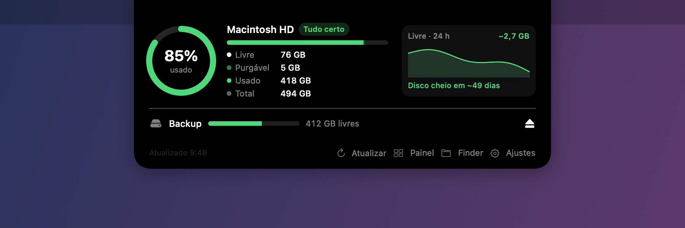
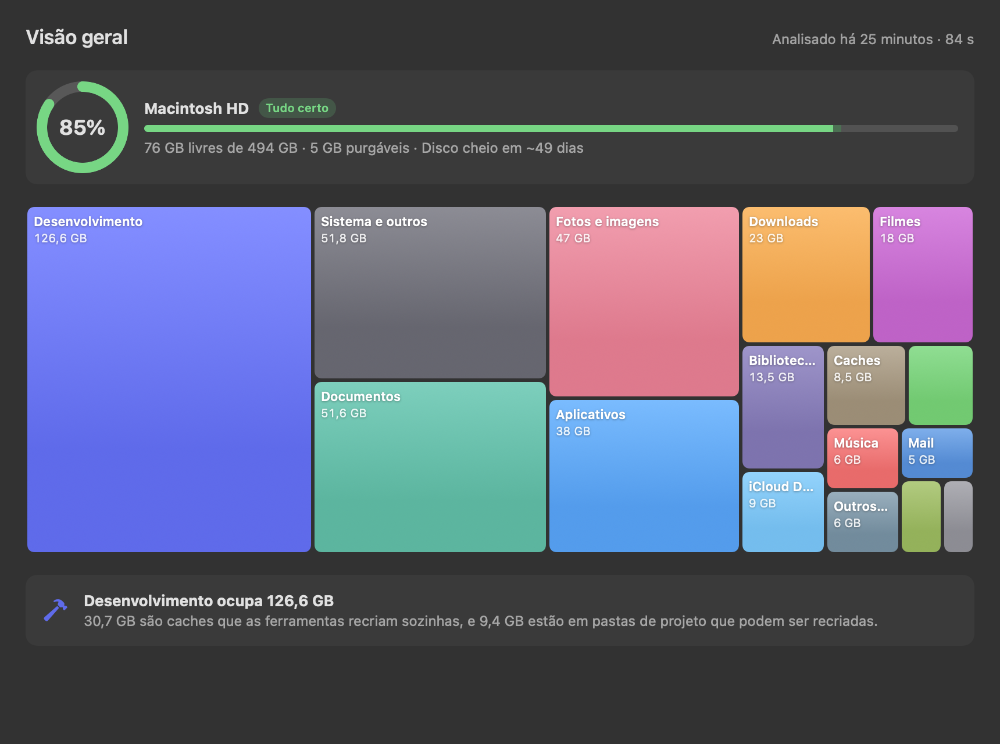
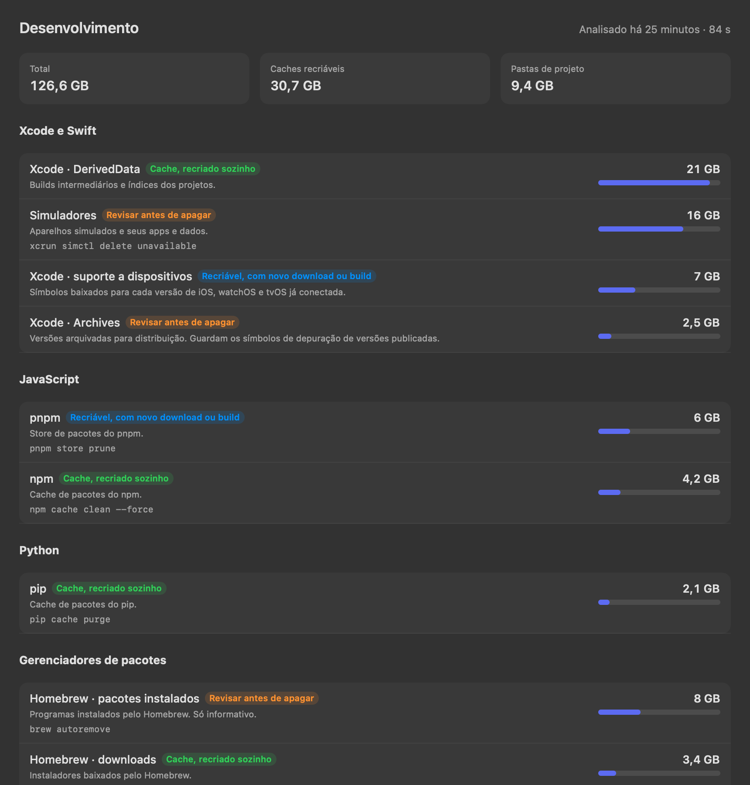
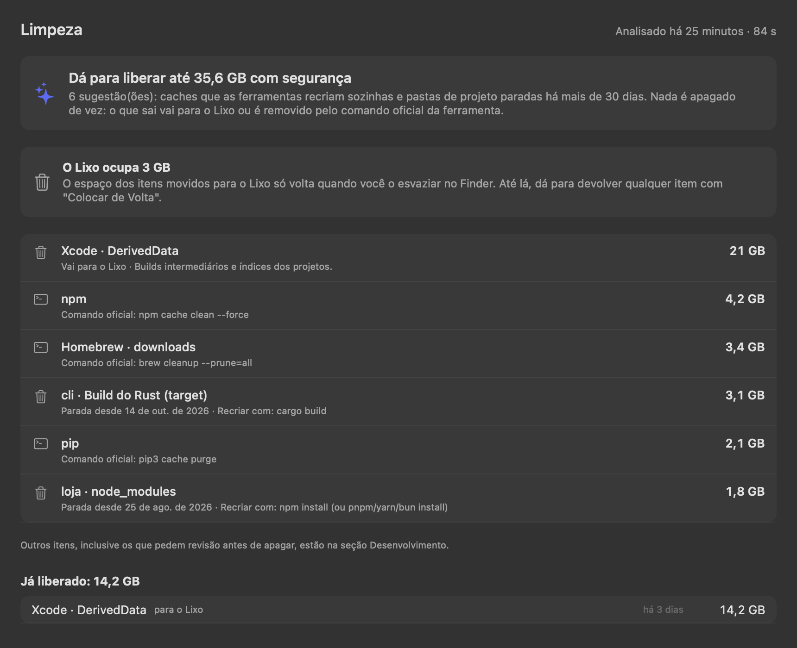

<div align="center">


[](https://github.com/alexccastelo/DiskNotch/actions/workflows/ci.yml)


**Um app para macOS que mostra no notch do MacBook quanto espaço livre o disco
tem, o que o próprio sistema ainda consegue liberar e quando, no ritmo atual,
o disco vai encher.**



</div>

Passe o mouse sob o notch para ver o disco de inicialização em detalhe, os
discos externos e a tendência das últimas 24 horas. Recolhido, ele ocupa só um
lado do notch e não cobre os ícones da barra de menus.

> **Status:** em desenvolvimento, fase 4 de 5. Veja o [ROADMAP.md](ROADMAP.md).

## Instalação

Ainda não há versão publicada para baixar. Por enquanto o DiskNotch é compilado
na própria máquina, **sem precisar do Xcode**: bastam as Command Line Tools da
Apple, com Swift 6.

```sh
xcode-select --install          # uma vez, se ainda não tiver
./build-app.sh                  # gera build/DiskNotch.app
./inicio-automatico.sh          # abre agora e a cada login
```

O app é assinado localmente (ad hoc) e não passa pelo Gatekeeper, porque não
sai da sua máquina. Ele precisa de macOS 15 ou mais novo e foi desenvolvido e
testado no macOS 27 "Golden Gate", num MacBook com notch. Em telas sem notch,
vira uma pílula no topo da tela.

## O que ele mostra


**Recolhido**, o notch ganha um anel de ocupação e os GB livres, sempre de um
lado só. No macOS 27 os ícones da barra de menus não aparecem como janelas, então
não há como medir o espaço livre ao redor deles. Por isso, em vez de se ajustar,
o painel simplesmente nunca passa da borda do notch do lado dos ícones. O lado
pode ser trocado no menu da barra.

**Expandido** (ao passar o mouse ou clicar), mostra:

- espaço livre, purgável, usado e total do disco de inicialização;
- uma barra de uso e o nível: verde, âmbar ("espaço baixo") ou vermelho ("espaço crítico");
- o espaço livre nas últimas 24 h, a variação no período e a previsão;
- discos externos e de rede, com botão de ejetar;
- atalhos para Atualizar, Painel, Finder e Ajustes (faixas, cores e alertas).

A janela do painel é maior que a forma desenhada, para a animação de abrir ter
espaço. Fora da forma visível, ela ignora o mouse, então os cliques passam
para as janelas logo abaixo do notch.

Os números são atualizados a cada 60 segundos, na hora ao montar ou ejetar um
disco, e quando o Mac acorda.

### Livre e purgável

O DiskNotch mostra o espaço livre do mesmo jeito que o Finder: já conta o que o
macOS consegue apagar sozinho quando precisa (caches, arquivos do iCloud
otimizados, snapshots locais do Time Machine). Essa parte aparece separada como
**purgável**. Por isso o número costuma ser maior que o "Avail" do `df`, que só
conta o que está livre agora.

## Alertas

Quando um disco local entra em **atenção** ou fica **crítico**, chega uma
notificação do macOS com o espaço que sobra e quanto ainda é purgável. Clicar
nela abre os Ajustes de Armazenamento.

- **Avisa uma vez por piora.** Continuar no mesmo nível não gera outro aviso; em
  nível crítico, há um lembrete por dia.
- **Folga de 1 ponto percentual.** O alerta só é "esquecido" quando o espaço
  sobe além do limite com folga, para não avisar várias vezes quando o uso
  oscila em torno dele.
- **Faixas ajustáveis** na seção Ajustes do painel (veja abaixo). As mesmas faixas
  definem as cores do notch, do menu, do painel e dos widgets.
- **Permissão.** O macOS pede para permitir as notificações na primeira vez. Até
  você responder, nenhum alerta é dado como enviado.

### Faixas e cores

Na seção **Ajustes** do painel (botão Ajustes no notch, ou "Faixas, cores e alertas…"
no menu da barra), você escolhe quando um disco passa a **espaço baixo** e a **espaço
crítico**:

| Definir por | Exemplo | Bom para |
|---|---|---|
| **Porcentagem livre** (padrão) | atenção abaixo de 20%, crítico abaixo de 10% | discos de tamanhos parecidos |
| **Espaço livre (GB)** | atenção abaixo de 50 GB, crítico abaixo de 20 GB | quando o que importa é o espaço que sobra |
| **Os dois** | o que disparar primeiro | discos de tamanhos muito diferentes |

Uma prévia mostra, para cada disco, onde ficam os limites e em que nível ele está
agora. "Crítico" fica sempre abaixo de "atenção": ao mudar um, o outro se ajusta.

As **cores** de cada nível (tudo certo, espaço baixo, espaço crítico) também podem
ser trocadas, com prévia do anel. Valem no notch, no menu, no painel e nos widgets,
e há um botão para voltar às cores padrão. Faixas e cores ficam nas preferências do
app (`id.nexum.disknotch`), que o widget lê.

## Histórico e previsão


O app grava a ocupação de cada disco local a cada 5 minutos. A seção
**Histórico** do painel (clique no gráfico do notch) mostra 24 h, 7 dias,
30 dias ou 1 ano, com as linhas dos limites de atenção e crítico e a tendência
tracejada.

A **previsão** é uma regressão linear do espaço livre nas últimas 2 semanas. Ela
precisa de pelo menos 6 h de dados e trata como estável uma perda menor que
100 MB por dia.

O histórico fica em `~/Library/Application Support/DiskNotch/history.sqlite` e é
compactado a cada 6 h, para não crescer sem limite:

| Idade | Guardado como |
|---|---|
| Até 48 h | Uma amostra a cada 5 min |
| De 48 h a 60 dias | Média por hora |
| Mais de 60 dias | Média por dia |

Um ano de histórico ocupa poucas centenas de KB.

O macOS não guarda um histórico do espaço livre, então os gráficos começam no
dia em que o app foi instalado. Também ficam lacunas nos períodos em que o Mac
esteve desligado: o gráfico liga os pontos, e a previsão leva em conta o horário
de cada amostra.

## Análise do disco



O **painel** (botão Painel no notch, ou "Abrir painel…" no menu da barra) descobre
o que ocupa o disco. A análise roda sob demanda, em segundo plano, e percorre a
pasta pessoal, os Aplicativos e o Homebrew numa passada só: cerca de 20 segundos
para 1 milhão de arquivos. O resultado fica salvo em
`~/Library/Application Support/DiskNotch/analysis.json`, então o painel abre com a
última análise.

| Seção | O que mostra |
|---|---|
| **Visão geral** | O disco, a previsão e um mapa em que cada categoria tem área proporcional ao espaço que ocupa. |
| **Limpeza** | O que dá para liberar com segurança, com confirmação e registro do que foi liberado. |
| **Desenvolvimento** | Caches de ferramentas e pastas de projeto, com o comando oficial de limpeza de cada uma. |
| **Categorias** | Aplicativos, Documentos, Fotos, Mail, Caches, Lixo e outras, em lista. |
| **Pastas e arquivos** | Mapa navegável das pastas grandes (clique para entrar) e os maiores arquivos. |
| **Histórico** | Os gráficos de 24 h a 1 ano. |
| **Volumes** | Todos os discos montados, com botão de ejetar. |
| **Ajustes** | Faixas de ocupação (porcentagem, GB ou os dois), cores de cada nível e alertas. |

**Cada byte entra numa categoria só.** O cache do pip fica dentro de
`~/Library/Caches`, mas conta só em Desenvolvimento; um `node_modules` dentro de
Documentos também. Assim as categorias somam exatamente o espaço medido, e o que
sobra do espaço usado vira **Sistema e outros**: o próprio macOS, apps do sistema,
memória virtual e arquivos de outros usuários.

### Desenvolvimento



Um catálogo de lugares conhecidos ([`DevCatalog.swift`](Sources/StorageCore/DevCatalog.swift)):

- **Xcode e Swift:** DerivedData, Archives, suporte a dispositivos, simuladores, SwiftPM, CocoaPods.
- **JavaScript:** npm, pnpm, Yarn, Bun, Playwright.
- **Python:** pip, uv, Conda.
- **Outras linguagens:** Gradle, Maven, Cargo, Go.
- **Gerenciadores de pacotes:** Homebrew (downloads e pacotes instalados).
- **Contêineres:** Docker Desktop, OrbStack.
- **Modelos de IA locais:** Ollama, LM Studio, Hugging Face.

Cada item diz quão seguro é liberar o espaço: **cache, recriado sozinho**;
**recriável**, com novo download ou build; ou **revisar antes de apagar**, quando
há dados seus, como simuladores, imagens do Docker e modelos de IA. Cada item
mostra o comando oficial da ferramenta, com um botão para copiar.

**Pastas de projeto** são `node_modules` (ao lado de um `package.json`), `.venv`
(com `pyvenv.cfg`), `.build` (ao lado de um `Package.swift`) e `target` (ao lado de
um `Cargo.toml`). Elas só são procuradas na pasta pessoal, fora da Biblioteca e de
pastas ocultas como `~/.npm`: ali, um `node_modules` é cache de ferramenta, não
projeto seu.

### Limpeza assistida



A seção **Limpeza** junta o que dá para liberar com segurança: caches que as
ferramentas recriam sozinhas e pastas de projeto paradas há mais de 30 dias (itens
com menos de 50 MB ficam de fora). Cada sugestão tem um botão **Liberar…**, que
mostra exatamente o que vai acontecer e só age depois da sua confirmação. O mesmo
botão aparece nas linhas da seção Desenvolvimento.

**Nada é apagado de vez.** Há só dois jeitos de liberar:

- **Comando oficial da ferramenta**, quando ela está instalada (o app procura no PATH
  do seu shell de login): `npm cache clean --force`, `pnpm store prune`,
  `yarn cache clean`, `bun pm cache rm`, `pip3 cache purge`, `uv cache clean`,
  `conda clean --all --yes`, `go clean -cache -modcache`, `brew cleanup --prune=all`,
  `xcrun simctl delete unavailable` e `pod cache clean --all`. Todos rodam sem
  perguntar nada e removem só cache. O comando aparece antes de rodar e a saída
  aparece na hora, com um botão para interromper.
- **Mover para o Lixo**, para caches sem comando (como o DerivedData do Xcode) e
  pastas de projeto. Dá para devolver pelo Finder com "Colocar de Volta", e o
  espaço volta quando você esvaziar o Lixo. O DiskNotch nunca esvazia o Lixo.

Antes de mover qualquer coisa, uma última barreira
([`Cleanup.swift`](Sources/StorageCore/Cleanup.swift)) recusa tudo o que não for um
caminho do catálogo ou uma pasta de projeto detectada, além de links simbólicos,
caminhos fora da pasta pessoal e pastas como a própria pasta pessoal, a Biblioteca,
Documentos e Downloads, mesmo que apareçam na lista. Itens que pedem revisão
(Docker, modelos de IA, Archives do Xcode) não têm botão de liberar: só o comando
para copiar e o atalho para o Finder.

Depois de cada limpeza, o app mede o item de novo e registra quanto foi liberado.
Uma sugestão pode ser escondida com o ícone de olho, e o painel avisa se o Xcode
estiver aberto antes de mexer no DerivedData ou nos simuladores.

### Acesso Total ao Disco

Sem essa permissão, o macOS não deixa ler Mail, Mensagens, a Lixeira e os dados de
outros apps, e essas partes aparecem como **parciais**. O DiskNotch só lê tamanhos;
nunca abre o conteúdo dos arquivos.

A permissão fica presa à assinatura do app. Com a assinatura ad hoc, ela muda a
cada build e a permissão se perde. Por isso, crie uma vez um certificado local, só
seu (não precisa de conta de desenvolvedor da Apple), e recompile:

```sh
Scripts/criar-certificado-local.sh   # cria "DiskNotch Local Signing" no chaveiro de login
./build-app.sh                       # passa a assinar com ele
```

Depois, em **Ajustes do Sistema › Privacidade e Segurança › Acesso Total ao Disco**,
ligue o DiskNotch (ou use **+** e escolha `build/DiskNotch.app`). O painel tem um
botão que abre esse lugar direto.

## Widgets

Widgets pequeno, médio e grande para a mesa e a Central de Notificações, com o
anel, os GB livres, o gráfico das últimas 24 h e a previsão. Clicar em um widget
abre o painel.

Para adicionar: clique com o botão direito na mesa, escolha **Editar Widgets** e
procure "DiskNotch".

A extensão é montada sem Xcode: compilada pelo Swift Package Manager, empacotada
pelo `build-app.sh` em `DiskNotch.app/Contents/PlugIns/DiskNotchWidget.appex` e
assinada localmente com sandbox. Dois detalhes que o Xcode resolve sozinho e aqui
são feitos à mão:

- **Ponto de entrada `_NSExtensionMain`.** Sem ele, a extensão cai ao iniciar, antes
  de registrar o tipo, e o widget nunca chega à galeria
  ([`Package.swift`](Package.swift)).
- **Chaves de plataforma e SDK no `Info.plist`** (`CFBundleSupportedPlatforms`,
  `DTSDKName` e outras), gravadas pelo `build-app.sh` com a versão do SDK instalado.

A extensão roda em sandbox, como o WidgetKit exige. Ela lê o disco por conta
própria e lê o histórico e os limites de alerta do app por duas exceções
temporárias de sandbox, só de leitura dos dados do DiskNotch
([`Support/Widget.entitlements`](Support/Widget.entitlements)). O app pede uma
atualização a cada 15 min ou quando o nível muda, para não gastar o limite diário
de atualizações do WidgetKit.

## Abrir no login

```sh
./inicio-automatico.sh            # liga
./inicio-automatico.sh --remover  # desliga
```

São dois LaunchAgents em `~/Library/LaunchAgents`:

| Agente | O que faz |
|---|---|
| `id.nexum.disknotch` | Abre o app direto no login, sem passar pelo shell, e o reabre se ele travar. Sair pelo menu não reabre. |
| `id.nexum.disknotch.rebuild` | Em baixa prioridade, recompila se algum arquivo do código mudou e reinicia o app. |

O app é aberto direto, e não por um script, porque logo após o boot o Mac fica
tão carregado que cada comando de shell leva dezenas de segundos. A primeira
versão, feita só com um script, demorava uns 5 minutos para mostrar o notch.

## Compilação

```sh
./build-app.sh                                  # compila em release e empacota o .app com o widget
open build/DiskNotch.app
swift run disknotch-probe                        # lê os discos pelo terminal, sem interface
swift run disknotch-probe --testar-alertas       # 25 casos: regra de alertas e faixas por %, GB ou os dois
swift run disknotch-probe --testar-historico     # 11 casos de histórico e previsão (70 dias simulados)
swift run disknotch-probe --historico            # resumo do histórico real gravado pelo app
swift run disknotch-probe --testar-analise       # 20 casos de varredura, categorias e treemap (pasta pessoal falsa)
swift run disknotch-probe --analisar             # análise real, com tempo, categorias e pastas de projeto
swift run disknotch-probe --testar-limpeza       # 21 casos: o que é oferecido e o que é recusado antes do Lixo
```

Com um duplo clique, [`iniciar-disknotch.command`](iniciar-disknotch.command) faz
o mesmo que o agente de login: recompila só se o código mudou e abre o app.

O app precisa rodar de dentro do `.app`: as notificações do macOS não funcionam
num executável solto, então `swift run DiskNotch` encerra com erro.

O ícone do app ([`Support/AppIcon.icns`](Support/AppIcon.icns)) é desenhado pelo próprio app, com o
mesmo anel do banner. Para gerá-lo de novo depois de mudar o desenho:

```sh
Scripts/gerar-icone.sh
```

Ele sai como um quadrado opaco de ponta a ponta, em 8 bits por canal e sem transparência,
porque é assim que o macOS 26+ aplica o formato arredondado e o acabamento de vidro. Um
ícone já arredondado, com margem transparente ou com 16 bits, vai para uma moldura cinza.

Rode com `DISKNOTCH_DEMO=1` para ver dados fixos de demonstração em vez do seu
disco. As imagens deste README são geradas a partir das telas reais do app, com
esses dados:

```sh
build/DiskNotch.app/Contents/MacOS/DiskNotch --render-readme-images "$PWD/docs/design"
```

## Arquitetura

```
Sources/
├── StorageCore/          sem interface: volumes, alertas, histórico, previsão e análise
│   ├── VolumeService     capacidade e metadados de cada volume
│   ├── AlertPolicy       quando notificar (sem repetir à toa)
│   ├── HistoryStore      histórico em SQLite e compactação
│   ├── Forecast          tendência e previsão de disco cheio
│   ├── DiskScanner       varredura paralela: tamanhos, árvore, maiores arquivos, pastas de projeto
│   ├── DevCatalog        caches e dados de ferramentas de desenvolvimento
│   ├── StorageCategories categorias, sem contar nada duas vezes
│   ├── Treemap           layout "squarified" do mapa
│   ├── FullDiskAccess    detecção do Acesso Total ao Disco
│   └── Cleanup           o que pode ser liberado e a barreira antes do Lixo
├── DiskNotchUI/          cores, anel, barra de uso, formato do notch e mapa
├── DiskNotch/            o app: notch, barra de menus, alertas, painel e modo demonstração
├── DiskNotchWidget/      a extensão de widgets
└── disknotch-probe/      ferramenta de linha de comando e testes
Scripts/                  certificado local de assinatura e geração do ícone
```

- **Leitura do disco:** `URL.resourceValues` com as chaves de capacidade do
  volume. O livre "para uso importante"
  (`volumeAvailableCapacityForImportantUsage`) inclui o purgável; a diferença
  para o livre estrito é o número "purgável".
- **Painel do notch:** um `NSPanel` sem borda, que não rouba o foco, acima da
  barra de menus e presente em todos os espaços, inclusive em tela cheia. A
  posição vem de `NSScreen.auxiliaryTopLeftArea` e `auxiliaryTopRightArea`.
- **Histórico em SQLite**, direto pela biblioteca do sistema, sem dependências.
- **Varredura:** soma o espaço alocado de cada arquivo (como o Finder), sem seguir
  links simbólicos nem entrar em outros volumes, com as pastas de primeiro nível em
  paralelo. Pastas acima de 100 MB guardam a lista de filhos, para o mapa navegar
  sem varrer de novo.
- **Uma cópia só:** se o macOS abrir uma segunda cópia do app (por um link de
  widget, por exemplo), ela repassa o link para a que já está aberta e fecha.

Planejamento e decisões: [ROADMAP.md](ROADMAP.md).

## Ressalvas

- **O notch não tem API oficial.** A posição é calculada à mão a partir das áreas
  que o sistema informa ao redor dele e pode mudar entre versões do macOS. O ícone
  na barra de menus fica sempre como alternativa.
- **O "purgável" é uma estimativa do macOS.** O sistema não diz exatamente o que
  vai apagar, nem quando. O número pode diferir um pouco dos Ajustes do Sistema,
  por isso o app mostra os dois valores.
- **Sem Xcode, sem macros do SwiftUI.** As Command Line Tools não trazem o plugin
  de macros do SwiftUI e do SwiftData: `@State`, `@Entry`, `#Preview` e `@Model`
  não compilam. O estado das views fica em classes `@Observable`, e o histórico
  usa SQLite.
- **Sem botão "Atualizar" no widget.** Botões interativos dependem de App Intents,
  cujos metadados só o Xcode gera. O app atualiza os widgets por conta própria.
- **Pastas de nuvem não são analisadas.** Google Drive, Dropbox, OneDrive e afins
  (`~/Library/CloudStorage`), e qualquer pasta sem cópia local, ficam de fora:
  percorrê-las obrigaria o serviço a baixar cada listagem da internet, o que é lento
  e pode travar. O painel lista o que foi pulado.
- **"Sistema e outros" é o que sobra.** Não há como medir o próprio macOS sem
  permissões de administrador, então ele é o espaço usado menos tudo o que foi medido.
- **Testes só da lógica.** Alertas, histórico, previsão, análise e limpeza têm testes
  automáticos no `disknotch-probe`, que o CI roda a cada push; a interface ainda é
  verificada à mão.

**Logs:** o app não tem janela principal, então o que importa para diagnóstico
vai para um arquivo:

```sh
tail -f ~/Library/Logs/DiskNotch-start.log
```

## Licença

[MIT](LICENSE) © 2026 alexccastelo
