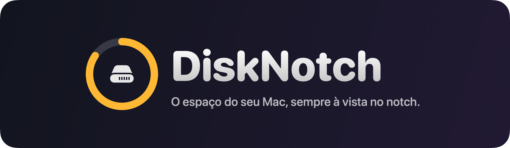
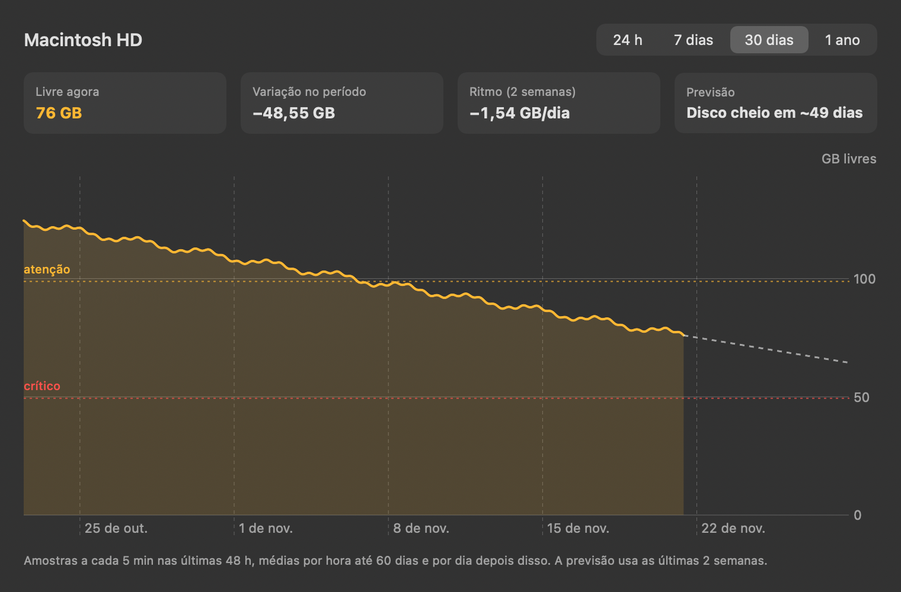

<div align="center">



[](https://github.com/alexccastelo/DiskNotch/actions/workflows/ci.yml)


**Um app para macOS que mostra no notch do MacBook quanto espaço livre o disco
tem, o que o próprio sistema ainda consegue liberar e quando, no ritmo atual,
o disco vai encher.**


</div>

Passe o mouse sob o notch para ver o disco de inicialização em detalhe, os
discos externos e a tendência das últimas 24 horas. Recolhido, ele ocupa só um
lado do notch e não cobre os ícones da barra de menus.

> **Status:** em desenvolvimento, fase 2 de 5. Veja o [ROADMAP.md](ROADMAP.md).

## Instalação

Ainda não há versão publicada para baixar. Por enquanto o DiskNotch é compilado
na própria máquina, **sem precisar do Xcode**: bastam as Command Line Tools da
Apple, com Swift 6.

```sh
xcode-select --install          # uma vez, se ainda não tiver
./build-app.sh                  # gera build/DiskNotch.app
./inicio-automatico.sh          # abre agora e a cada login
```

O app é assinado localmente (ad hoc) e não passa pelo Gatekeeper, porque não
sai da sua máquina. Ele precisa de macOS 15 ou mais novo e foi desenvolvido e
testado no macOS 27 "Golden Gate", num MacBook com notch. Em telas sem notch,
vira uma pílula no topo da tela.

## O que ele mostra


**Recolhido**, o notch ganha um anel de ocupação e os GB livres, sempre de um
lado só. No macOS 27 os ícones da barra de menus não aparecem como janelas, então
não há como medir o espaço livre ao redor deles. Por isso, em vez de se ajustar,
o painel simplesmente nunca passa da borda do notch do lado dos ícones. O lado
pode ser trocado no menu da barra.

**Expandido** (ao passar o mouse ou clicar), mostra:

- espaço livre, purgável, usado e total do disco de inicialização;
- uma barra de uso e o nível: verde, âmbar ("espaço baixo") ou vermelho ("espaço crítico");
- o espaço livre nas últimas 24 h, a variação no período e a previsão;
- discos externos e de rede, com botão de ejetar;
- atalhos para Atualizar, Histórico, Finder e Ajustes de Armazenamento.

A janela do painel é maior que a forma desenhada, para a animação de abrir ter
espaço. Fora da forma visível, ela ignora o mouse, então os cliques passam
para as janelas logo abaixo do notch.

Os números são atualizados a cada 60 segundos, na hora ao montar ou ejetar um
disco, e quando o Mac acorda.

### Livre e purgável

O DiskNotch mostra o espaço livre do mesmo jeito que o Finder: já conta o que o
macOS consegue apagar sozinho quando precisa (caches, arquivos do iCloud
otimizados, snapshots locais do Time Machine). Essa parte aparece separada como
**purgável**. Por isso o número costuma ser maior que o "Avail" do `df`, que só
conta o que está livre agora.

## Alertas

Quando um disco local entra em **atenção** ou fica **crítico**, chega uma
notificação do macOS com o espaço que sobra e quanto ainda é purgável. Clicar
nela abre os Ajustes de Armazenamento.

- **Avisa uma vez por piora.** Continuar no mesmo nível não gera outro aviso; em
  nível crítico, há um lembrete por dia.
- **Folga de 1 ponto percentual.** O alerta só é "esquecido" quando o espaço
  sobe além do limite com folga, para não avisar várias vezes quando o uso
  oscila em torno dele.
- **Limites ajustáveis** no menu da barra (padrão: 20% e 10% livres). Os mesmos
  limites definem as cores do notch, do menu e dos widgets.
- **Permissão.** O macOS pede para permitir as notificações na primeira vez. Até
  você responder, nenhum alerta é dado como enviado.

## Histórico e previsão



O app grava a ocupação de cada disco local a cada 5 minutos. A janela
**Histórico** (no notch ou em "Ver histórico…" no menu) mostra 24 h, 7 dias,
30 dias ou 1 ano, com as linhas dos limites de atenção e crítico e a tendência
tracejada.

A **previsão** é uma regressão linear do espaço livre nas últimas 2 semanas. Ela
precisa de pelo menos 6 h de dados e trata como estável uma perda menor que
100 MB por dia.

O histórico fica em `~/Library/Application Support/DiskNotch/history.sqlite` e é
compactado a cada 6 h, para não crescer sem limite:

| Idade | Guardado como |
|---|---|
| Até 48 h | Uma amostra a cada 5 min |
| De 48 h a 60 dias | Média por hora |
| Mais de 60 dias | Média por dia |

Um ano de histórico ocupa poucas centenas de KB.

O macOS não guarda um histórico do espaço livre, então os gráficos começam no
dia em que o app foi instalado. Também ficam lacunas nos períodos em que o Mac
esteve desligado: o gráfico liga os pontos, e a previsão leva em conta o horário
de cada amostra.

## Widgets

Widgets pequeno, médio e grande para a mesa e a Central de Notificações, com o
anel, os GB livres, o gráfico das últimas 24 h e a previsão. Clicar em um widget
abre o histórico.

Para adicionar: clique com o botão direito na mesa, escolha **Editar Widgets** e
procure "DiskNotch".

A extensão é montada sem Xcode: compilada pelo Swift Package Manager, empacotada
pelo `build-app.sh` em `DiskNotch.app/Contents/PlugIns/DiskNotchWidget.appex` e
assinada localmente com sandbox. Dois detalhes que o Xcode resolve sozinho e aqui
são feitos à mão:

- **Ponto de entrada `_NSExtensionMain`.** Sem ele, a extensão cai ao iniciar, antes
  de registrar o tipo, e o widget nunca chega à galeria
  ([`Package.swift`](Package.swift)).
- **Chaves de plataforma e SDK no `Info.plist`** (`CFBundleSupportedPlatforms`,
  `DTSDKName` e outras), gravadas pelo `build-app.sh` com a versão do SDK instalado.

A extensão roda em sandbox, como o WidgetKit exige. Ela lê o disco por conta
própria e lê o histórico e os limites de alerta do app por duas exceções
temporárias de sandbox, só de leitura dos dados do DiskNotch
([`Support/Widget.entitlements`](Support/Widget.entitlements)). O app pede uma
atualização a cada 15 min ou quando o nível muda, para não gastar o limite diário
de atualizações do WidgetKit.

## Abrir no login

```sh
./inicio-automatico.sh            # liga
./inicio-automatico.sh --remover  # desliga
```

São dois LaunchAgents em `~/Library/LaunchAgents`:

| Agente | O que faz |
|---|---|
| `id.nexum.disknotch` | Abre o app direto no login, sem passar pelo shell, e o reabre se ele travar. Sair pelo menu não reabre. |
| `id.nexum.disknotch.rebuild` | Em baixa prioridade, recompila se algum arquivo do código mudou e reinicia o app. |

O app é aberto direto, e não por um script, porque logo após o boot o Mac fica
tão carregado que cada comando de shell leva dezenas de segundos. A primeira
versão, feita só com um script, demorava uns 5 minutos para mostrar o notch.

## Compilação

```sh
./build-app.sh                                  # compila em release e empacota o .app com o widget
open build/DiskNotch.app
swift run disknotch-probe                        # lê os discos pelo terminal, sem interface
swift run disknotch-probe --testar-alertas       # 11 casos da regra de alertas
swift run disknotch-probe --testar-historico     # 11 casos de histórico e previsão (70 dias simulados)
swift run disknotch-probe --historico            # resumo do histórico real gravado pelo app
```

Com um duplo clique, [`iniciar-disknotch.command`](iniciar-disknotch.command) faz
o mesmo que o agente de login: recompila só se o código mudou e abre o app.

O app precisa rodar de dentro do `.app`: as notificações do macOS não funcionam
num executável solto, então `swift run DiskNotch` encerra com erro.

Rode com `DISKNOTCH_DEMO=1` para ver dados fixos de demonstração em vez do seu
disco. As imagens deste README são geradas a partir das telas reais do app, com
esses dados:

```sh
build/DiskNotch.app/Contents/MacOS/DiskNotch --render-readme-images "$PWD/docs/design"
```

## Arquitetura

```
Sources/
├── StorageCore/        sem interface: volumes, alertas, histórico e previsão
│   ├── VolumeService   capacidade e metadados de cada volume
│   ├── AlertPolicy     quando notificar (sem repetir à toa)
│   ├── HistoryStore    histórico em SQLite e compactação
│   └── Forecast        tendência e previsão de disco cheio
├── DiskNotchUI/        cores, anel, barra de uso e formato do notch
├── DiskNotch/          o app: notch, barra de menus, alertas, histórico e modo demonstração
├── DiskNotchWidget/    a extensão de widgets
└── disknotch-probe/    ferramenta de linha de comando e testes
```

- **Leitura do disco:** `URL.resourceValues` com as chaves de capacidade do
  volume. O livre "para uso importante"
  (`volumeAvailableCapacityForImportantUsage`) inclui o purgável; a diferença
  para o livre estrito é o número "purgável".
- **Painel do notch:** um `NSPanel` sem borda, que não rouba o foco, acima da
  barra de menus e presente em todos os espaços, inclusive em tela cheia. A
  posição vem de `NSScreen.auxiliaryTopLeftArea` e `auxiliaryTopRightArea`.
- **Histórico em SQLite**, direto pela biblioteca do sistema, sem dependências.

Planejamento e decisões: [ROADMAP.md](ROADMAP.md).

## Ressalvas

- **O notch não tem API oficial.** A posição é calculada à mão a partir das áreas
  que o sistema informa ao redor dele e pode mudar entre versões do macOS. O ícone
  na barra de menus fica sempre como alternativa.
- **O "purgável" é uma estimativa do macOS.** O sistema não diz exatamente o que
  vai apagar, nem quando. O número pode diferir um pouco dos Ajustes do Sistema,
  por isso o app mostra os dois valores.
- **Sem Xcode, sem macros do SwiftUI.** As Command Line Tools não trazem o plugin
  de macros do SwiftUI e do SwiftData: `@State`, `@Entry`, `#Preview` e `@Model`
  não compilam. O estado das views fica em classes `@Observable`, e o histórico
  usa SQLite.
- **Sem botão "Atualizar" no widget.** Botões interativos dependem de App Intents,
  cujos metadados só o Xcode gera. O app atualiza os widgets por conta própria.
- **Testes só da lógica.** Alertas, histórico e previsão têm testes automáticos no
  `disknotch-probe`, que o CI roda a cada push; a interface ainda é verificada à mão.

**Logs:** o app não tem janela principal, então o que importa para diagnóstico
vai para um arquivo:

```sh
tail -f ~/Library/Logs/DiskNotch-start.log
```

## Licença

[MIT](LICENSE) © 2026 alexccastelo
